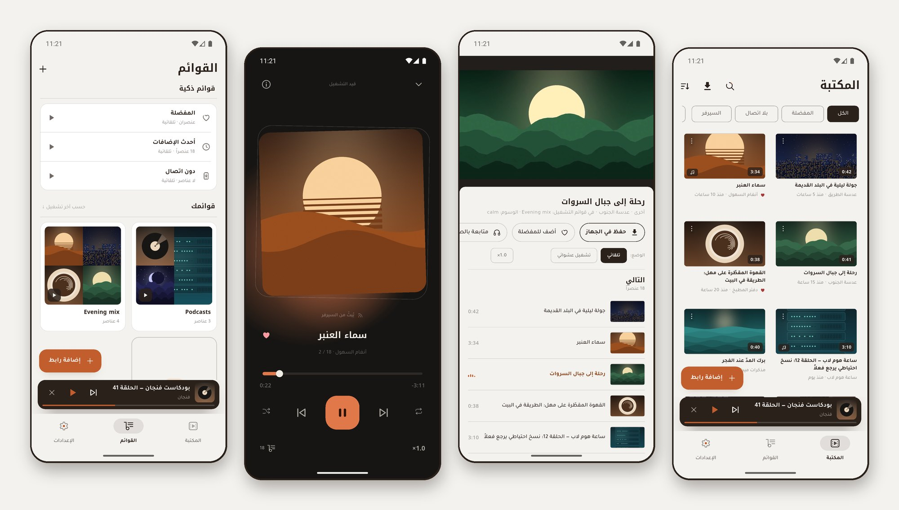
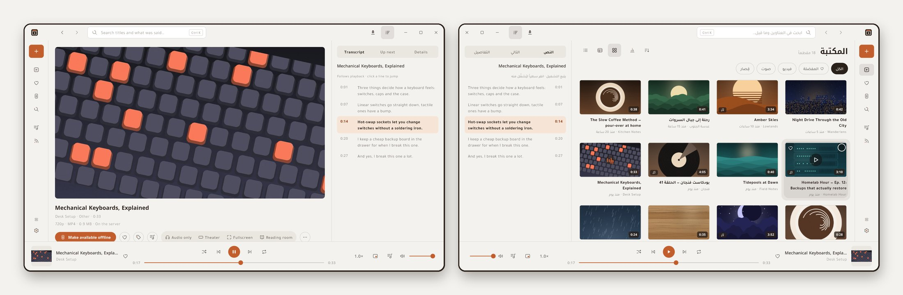
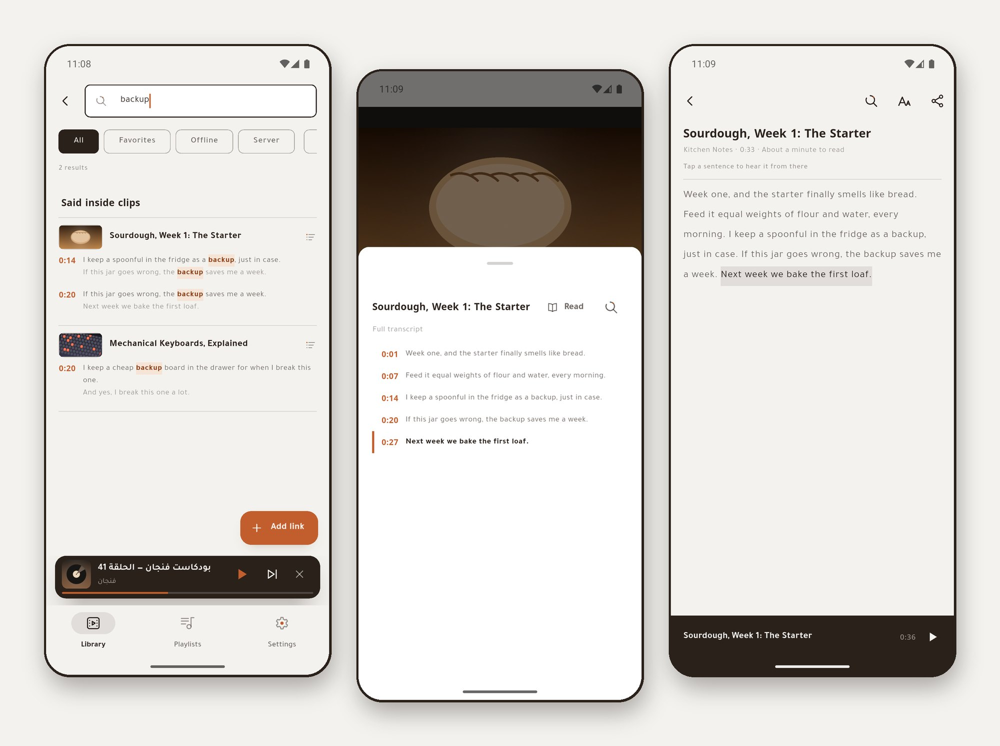
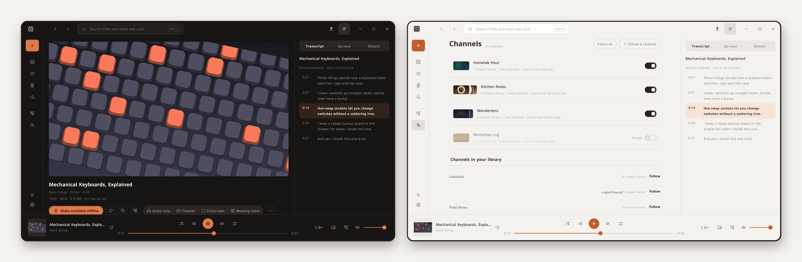
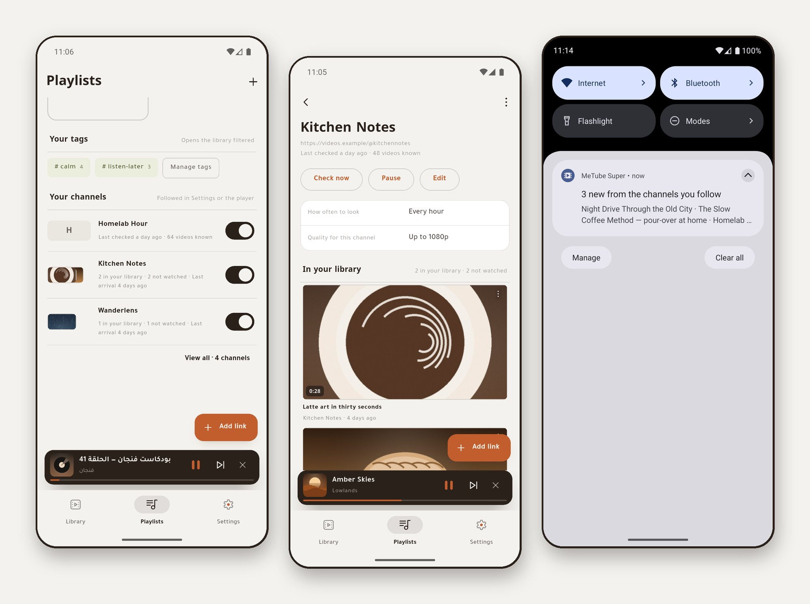
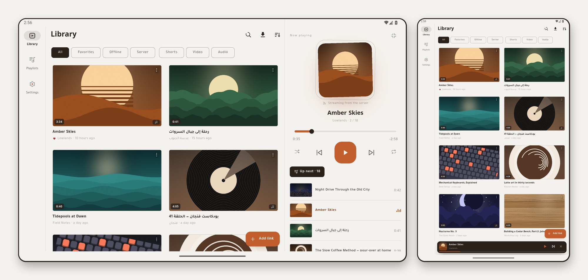
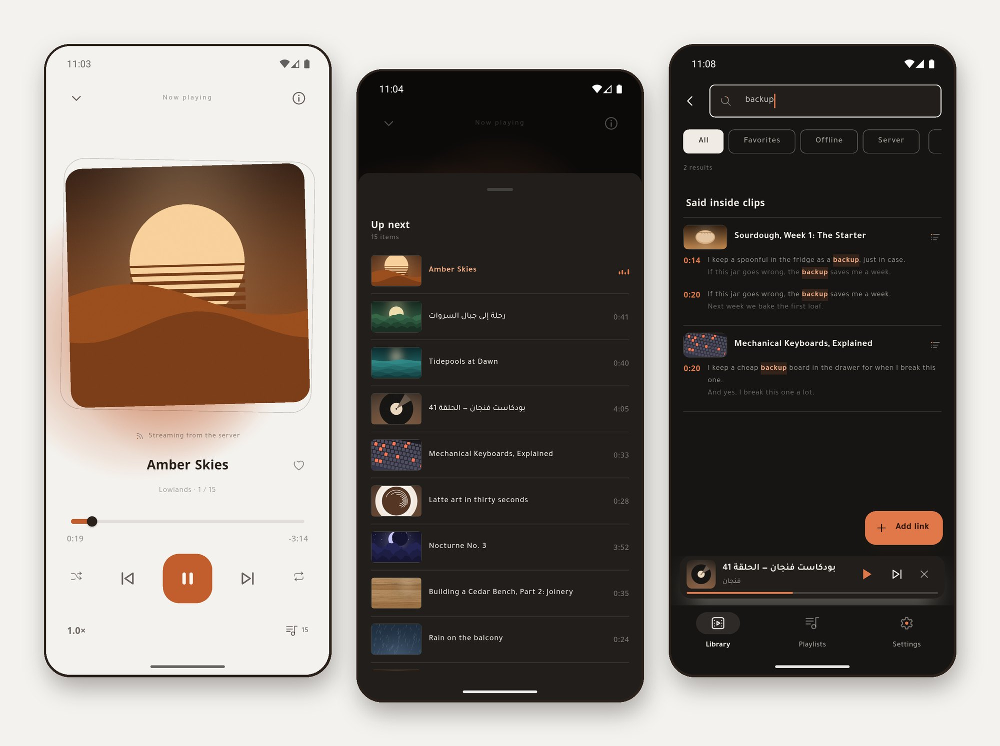
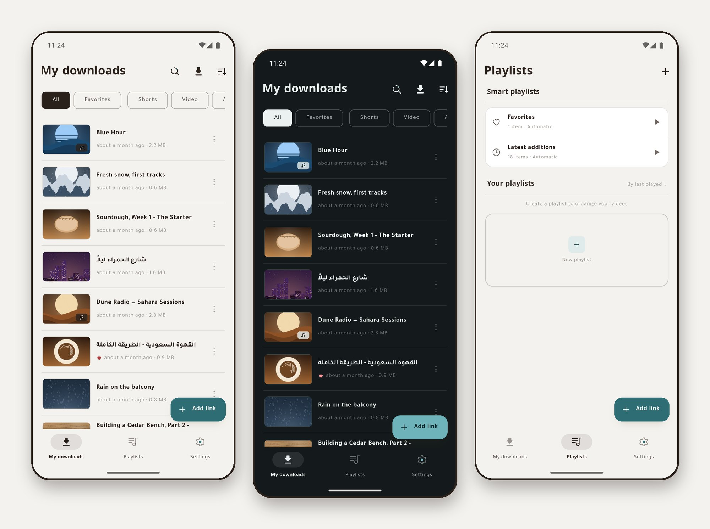

# MeTube Mobile

[English](README.md) · **العربية**

[](https://github.com/sagheerys/metube-mobile/actions/workflows/ci.yml)
[](https://github.com/sagheerys/metube-mobile/releases/latest)
[](LICENSE)
[](#المتطلبات)
[](https://flutter.dev)

**تطبيقا أندرويد وتطبيق ويندوز لسيرفر [MeTube](https://github.com/alexta69/metube)
ذاتي الاستضافة** — أداة التنزيل المبنية على yt-dlp التي تشغّلها على NAS أو
مختبرك المنزلي. أرسل الرابط من هاتفك أو من حاسوبك، وتابع التنزيل وهو يجري،
ثم أبقِ الملف على السيرفر وشغّله بثاً، أو اسحبه للجهاز ودع السيرفر ينظّف
نفسه. ويستطيع MeTube Super وMeTube Ember أيضاً أن **يتابعا قناة**: ينزّل
سيرفرك كل مقطع جديد وحده، ويخبرك التطبيق حين يصل. ويستطيعان **البحث داخل
مقاطعك** فيجدان ما قيل فيها، لا عناوينها وحدها. مكتوبة بـFlutter في مستودع
واحد، بالعربية والإنجليزية، للجوال والتابلت وويندوز، وبرمجية حرة برخصة GPL.

<p align="center">
  
</p>
<p align="center"><sub>MeTube Super — المكتبة الموحَّدة، وبثّ فيديو مع ترجمته وقائمة «التالي»، ومشغل الصوت ليلاً، وقوائم التشغيل. كل عنوان وغلاف هنا مخترَع.</sub></p>

<p align="center">
  
</p>
<p align="center"><sub>MeTube Ember، الجديد في 2.7.0 — المكتبة نفسها على ويندوز: النص يتبع الفيديو ونقرة تنقلك إلى أي سطر، وعلى اليمين المكتبة بالعربية.</sub></p>

<p align="center">
  
</p>
<p align="center"><sub>MeTube Lite من البداية للنهاية: شارك الرابط، فينزّله السيرفر، ويسحبه الهاتف، وينظّف السيرفر نفسه. البيانات مخترعة للعرض، والانتظار مسرَّع ثلاث مرات.</sub></p>

> **غير رسمي.** المشروع لا يتبع MeTube ولا yt-dlp ولا يمثّلهما ولا يحمل
> تزكيةً منهما، وإنما هو عميل مستقل يتحدث إلى سيرفر MeTube عبر واجهته
> البرمجية. الاسم يُذكر لبيان ما تتصل به التطبيقات لا أكثر.

| | **MeTube Lite** | **MeTube Super** | **MeTube Ember** |
|---|---|---|---|
| يعمل على | أندرويد | أندرويد | ويندوز 10 و11 (x64) |
| لمن | العائلة والأصدقاء الذين يريدون الملف وحسب | من يدير السيرفر | الشخص نفسه، على الحاسوب |
| بعد اكتمال التحميل | يسحبه للجهاز ثم **يحذفه من السيرفر** | **يُبقيه على السيرفر** | **يُبقيه على السيرفر**، ونسخة لهذا الحاسوب حين تطلب |
| المكتبة | مسح للمجلد المحلي | `/history` والفهرس المحلي موحَّدين في قائمة واحدة | المكتبة الموحَّدة نفسها، شبكةً أو جدولاً أو قائمة مضغوطة |
| التشغيل | ملفات محلية | بثّ من السيرفر **و**ملفات محلية | بثّ وملفات محلية، في النافذة أو نافذة مصغّرة |
| الحصري | خيار الاقتصار على Wi‑Fi، وتنظيف السيرفر | اشتراكات القنوات، والبحث داخل المقاطع، وترجمة فوق الفيديو، ووسوم، وتحميل دفعي، و«إتاحة دون اتصال»، وتبديل عناوين السيرفر | كل ما في عمود Super، ومعه Ctrl+K، وغرفة القراءة، وسحب المقطع إلى المستكشف، ولوحة المفاتيح |

التطبيقات الثلاثة تتقاسم حزم النواة والوسائط والتصميم نفسها، وتصدر
**بالعربية والإنجليزية** بتخطيط يبدأ من اليمين.

## الميزات

<details>
<summary><strong>في تطبيقَي الجوال معاً</strong> — الروابط، والتنزيل، والمكتبة، والتشغيل، والقِصار، والتابلت، والقوائم، والإعدادات، والتحديث</summary>

**إدخال الرابط.** الصقه، أو دع زرّ الإضافة يلاحظ رابطاً موجوداً في الحافظة؛
أو شارك إلى التطبيق من يوتيوب أو تيك توك أو غيرهما — يعمل والتطبيق مغلق
تماماً، ويقبل عدة روابط دفعة واحدة. الروابط تُعرَف وتُطبَّع في يوتيوب وX
وإنستغرام وتيك توك وفيسبوك وفيميو وريديت ومقاطع تويتش وساوندكلاود، والروابط
القصيرة تُتَتبَّع (بلا هبوط من HTTPS إلى HTTP)، ورابط قائمة التشغيل يفتح
شاشة الدفعات بدل إضافة عنصر واحد.

**التحميل.** أربع مراحل — تسليم الرابط للسيرفر، ومتابعة تقدّمه، وسحب الملف،
ثم تطبيق سياسة الحذف — بنِسَب حيّة، وتحميل واحد في كل مرة حتى لا يُرهَق سيرفر
صغير، وإلغاء نظيف يحذف الجزء المسحوب وينظّف السيرفر، وثلاث محاولات بتراجع
تدريجي عند انقطاع الاتصال، وأخطاء **تُسمّى** لا تُبتلع (المنصة التي تطلب
تسجيل دخول تقول ذلك). ولكلٍّ من التقدّم والاكتمال والفشل إشعاره.

**فيديو وقِصار وصوت.** رقاقات المكتبة تضع كل مقطع تحت واحد منها فقط، فترى
الفيديوهات بلا القِصار.

**التحميل الدفعي.** قائمة التشغيل تصل كشاشة: كل عنصر بمدّته، تختار بعضها أو
كلها، ومجموع ما اخترت، وفيديو أو صوت، وجودة واحدة للدفعة.

**المكتبة.** بحث بالعنوان؛ فرز بالتاريخ أو الاسم أو الحجم مع حفظ الاختيار؛
تبديل بين بطاقات غنية وقائمة مضغوطة؛ سحب للتحديث؛ فصل الفيديو عن الصوت؛
وضغطة مطوّلة تدخل التحديد المتعدد للحذف أو المشاركة أو الإضافة لقائمة دفعةً
واحدة. والمصغّرات من كاش على القرص وفي الذاكرة، أو تُولَّد من الفيديو المحلي،
أو تُقرأ من الغلاف المضمَّن في ملفات الصوت، أو تُجلب لساوندكلاود.

**التشغيل.** ثلاثة أشكال — عمودي غامر، وأفقي بأدوات كاملة، ووضع صوتي بغلاف —
مع قائمة انتظار داخل المشغّل، وتشغيل تلقائي للتالي، وتكرار واحد أو الكل،
وعشوائي، وسرعة تشغيل محفوظة، واستئناف من حيث توقّفت، وإبقاء الشاشة مضاءة.
والصوت يكمل في الخلفية بإشعار وسائط وأزرار على شاشة القفل، ومشغّل مصغّر يبقى
فوق الشاشات الرئيسة، والخروج من مشغّل الفيديو يعرض متابعة العنصر نفسه صوتاً
**من الثانية نفسها**.

**القِصار.** أي مقطع عمودي مدّته ثلاث دقائق أو أقل يفتح في مسار غامر بالسحب
يتخطّى ما ليس قصيراً، ونقرة توقف، ونقرتان تضيفان للمفضّلة، وله رقاقته في
المكتبة.

**التابلت.** يستفيد التطبيقان من مساحة التابلت، عمودياً كان أو أفقياً، بدل
أن يمطّا تخطيط الجوال: فينتقل التنقّل إلى شريط جانبي، وتُفتح الإعدادات في
لوحتين، وتتوزّع عروض المكتبة على أعمدة وتظهر القائمة جدولاً. وحين يكون
التابلت أفقياً تجاور لوحةُ «قيد التشغيل» المكتبةَ، ويُعرض الفيديو بجانب
تفاصيله وقائمة «التالي». وتشمل الميزة التابلتات الصغيرة بقياس 8 بوصات، ويبقى
الجوال على تخطيطه المعتاد.

**المفضّلة والقوائم.** قلب على كل بطاقة؛ وقوائم تنشئها وتعيد ترتيبها بالسحب
وتشغّلها بالترتيب أو عشوائياً؛ وقوائم ذكية تصون نفسها — المفضّلة، وأحدث
الإضافات، و(في Super) كل ما هو متاح دون اتصال.

**الإعدادات والأمان.** تبدأ الإعدادات بصفحة رئيسة قصيرة من ثلاث مجموعات
(السيرفر والتطبيق والبيانات)، يعرض كل صف فيها قيمة الإعداد الحالية. وفيها
الجودة الافتراضية، والمظهر (نظام أو فاتح أو داكن)،
واللغة — عربية أو إنجليزية، تُوافق لغة الهاتف أول تشغيل. والنسخ الاحتياطي
**نصّي لا يحمل سرّاً**، يُكتب تلقائياً بعد كل تغيير، ويحتفظ بآخر سبع نسخ
مؤرَّخة، وتستعيد باختيار تاريخ، ويمكن تصديره؛ والتنسيقات المشفّرة الثلاثة
القديمة ما زالت تُقرأ. وعارض السجلّات التشخيصي لا يُشارَك إلا بعد إزالة
الروابط وعناوين IP والاعتمادات ومسارات التخزين.

**التحديث الذاتي.** كل تطبيق يفحص هذا المستودع بحثاً عن إصداره الأحدث، ينزّل
الـAPK ويسلّمه لمثبّت النظام. لا يُثبَّت شيء بلا تأكيدك، ويمكن تخطّي إصدار.
وأول فتح بعد التحديث يعرض الجديد فيه، و«الإعدادات ← التحديثات» تعيد فتحه متى
شئت.

</details>

<details>
<summary><strong>MeTube Ember (ويندوز)</strong> — المكتبة في نافذة، وCtrl+K، وغرفة القراءة، والقنوات، والنسخ إلى الحاسوب، والمزامنة</summary>

تطبيق مالك السيرفر على الحاسوب، جديد في 2.7.0، يقرأ السيرفر نفسه الذي يقرؤه
MeTube Super:

- **المكتبة في نافذة**: شبكةً أو جدولاً أو قائمة مضغوطة، والمشغّل بجانبها،
  ونافذة مصغّرة تبقى فوق كل شيء، والنص يتبع الفيديو في لوحة جانبية.
- **Ctrl+K** يبحث في العناوين وفيما قيل فيها، وينفّذ أي أمر؛ و`?` يعرض كل
  الاختصارات، وأزرار الوسائط ولوحة وسائط ويندوز تعمل كما ينبغي.
- **غرفة القراءة** للمحاضرات الطويلة، والفصول، ونسخ الاقتباس بثانيته ورابطه،
  وإحصاءات المكتبة التي تقترح ولا تحذف شيئاً.
- **القنوات وما يصل منها**، كما في Super، مع إشعار ويندوز حين تأتي قناة
  تتابعها بجديد.
- **إلى هذا الحاسوب**: نزّل مقطعاً، أو أبقِ نسخة دون اتصال، أو اسحب المقطع إلى
  المستكشف أو سطح المكتب؛ وCtrl+C ينسخ رابطه، وCtrl+Shift+C ينسخ الملف نفسه.
- **زر «إلى Ember» في متصفحك**: نقرة على صفحة أي فيديو تفتح نافذة الإضافة
  بالرابط جاهزاً، وروابط إضافات MeTube للمتصفح تفتحها أيضاً.
- **المزامنة مع جوالك**، اختيارية ومتوقفة حتى تختار مجلداً: الوسوم والمفضلة
  والقوائم ومواضع التوقف والنصوص تنتقل بين Super وEmber عبر مجلد يزامنه برنامج
  تختاره.
- يُثبَّت لمستخدمك وحده **بلا صلاحيات مدير**، ويجد سيرفرك في شبكة البيت حين
  تُعدّه، ويبقى بجانب الساعة بعد الإغلاق إن أردت، ويحدّث نفسه.

</details>

<details>
<summary><strong>حصري لـ MeTube Lite</strong> — يسحب الملف إلى الجوال ثم ينظّف السيرفر، وWi-Fi فقط</summary>

- **يسحب الملف للهاتف ثم يحذفه من السيرفر**، فلا يمتلئ سيرفر تتشارك فيه مع
  العائلة والأصدقاء.
- **خيار الاقتصار على Wi‑Fi** — مطفأ حتى تشغّله — يمنع السحب على بيانات
  الجوّال؛ والمهام تنتظر وتُستأنف وحدها.
- مكتبة تُبنى بمسح مجلد التحميل الخاص بالتطبيق، مع مرشّح منصّة بعدّادات حيّة.
- الملفات المكتملة تُسجَّل في أندرويد فتظهر في معرض الهاتف.

</details>

<details>
<summary><strong>حصري لـ MeTube Super</strong> — الاشتراكات، والبحث داخل المقاطع، والقراءة مع التشغيل، والترجمة، والوسوم، ودون اتصال، والمزامنة</summary>

- **الاشتراكات**: تابع قناة أو قائمة تشغيل، فيفحصها سيرفر MeTube في مواعيد
  تختارها وينزّل كل مقطع جديد إلى المكتبة نفسها — ما يظهر من الآن فقط، لا أرشيف
  القناة. أوقفها مؤقتاً، أو أعد تسميتها، أو افحصها فوراً، أو اقصرها على عناوين
  تحوي كلمة. وإشعار واحد لكل دفعة يأتي بها اشتراك، يظهر حين يتصل التطبيق
  بالسيرفر؛ وما تنزّله أنت من أي جهاز لا يُعلَن وصولاً أبداً. تحتاج
  نسخة MeTube حديثة تدعم الاشتراكات، ومع الأقدم منها يقول التطبيق ذلك صراحة.
- **البحث داخل المقاطع** (مطفأ حتى تشغّله من الإعدادات ← النصوص): كل مقطع
  يوتيوب تضيفه يُجلب نصّه من سيرفرك ويُحفظ في الجوال، فيعرض بحث المكتبة أيضاً
  المقاطع التي قيلت فيها كلماتك، مع اللحظة في كلٍّ منها. اضغط واحدة فيبدأ
  التشغيل من تلك الثانية. وإن ضُبط السيرفر ليكتب الترجمة بجانب كل مقطع (سطر
  واحد في إعداده، في دليل الإعداد) شمل ذلك كل ما ينزّله، والاشتراكات معه.
- **اقرأ النص**: المقطع الذي له نص يفتحه بجانب مشغل الصوت أو الفيديو، والسطر
  الذي يُقال يُعلَّم أثناء التشغيل، والضغط على أي سطر ينقلك إليه.
- **ترجمة فوق الفيديو**: المقطع الذي له نص يمكنه عرض كلماته فوق الصورة لحظة
  نطقها، بثلاثة أحجام وبخلفية تختارها. والمقطع الذي له ترجمة بلغتين ينتقل
  بينهما بزر واحد (وفي القِصار بالضغط على الكلمات نفسها)، ويُحفظ اختيارك.
- **الكوكيز من الجوال** للمواقع التي تطلب تسجيل دخول: اختر الملفات المصدَّرة
  من متصفحك، لعدة منصات معاً، فتُدمج في الملف الواحد الذي يحفظه السيرفر.
- **يُبقي الملف على السيرفر**، ويدمج `/history` مع الفهرس المحلي في مكتبة
  واحدة مفتاحها الرابط المُقنون، بمرشّحات: الكل، وما هو دون اتصال، وما هو على
  السيرفر.
- **بثّ من السيرفر** بالمصادقة، مع تفضيل النسخة المحلية متى وُجدت — وموضع
  الاستئناف مشترك بينهما.
- **وسوم** تنشئها وتعلّق بها ما تشاء، رقاقاتٍ في المكتبة وشاشةً لإعادة
  التسمية والحذف.
- **«إتاحة دون اتصال»**: نسخة محلية مع بقاء الأصل على السيرفر؛ وإزالة النسخة
  المحلية وحدها؛ ومشاركة ذكية تُرسل الملف المحلي إن وُجد وتنزّل ثم تشارك إن لم
  يوجد.
- عمليات دفعية، ومنها توسيم عدة عناصر مرة واحدة.
- **المزامنة مع الحاسوب** (اختيارية): تعكس وسومك ومفضلتك وقوائمك ومواضع
  التوقف والنصوص مع MeTube Ember عبر مجلد تختاره، وتنبّهك حين يصمت جهاز
  أياماً.
- **عنوان محلي وعناوين خارجية**، تُجرَّب عند كل تغيّر شبكة فيستعمل الهاتف
  المسار السريع في البيت والنفق خارجه، مع نقطة حالة حيّة لكل عنوان وبطاقة
  للسيرفر في الإعدادات.

</details>

## لقطات

**البحث داخل المقاطع** (Super وEmber): كلمة وُجدت داخل مقطعين، والنص يتبع
التشغيل، ووضع القراءة:



<details>
<summary><strong>شاشات أخرى</strong> — Ember ليلاً، والاشتراكات، والتابلت، والمشغّلات، وMeTube Lite</summary>
<br>

**MeTube Ember ليلاً، وقنواته** — النص بجانب الفيديو، والقنوات التي يتابعها
سيرفرك وما جاء من كلٍّ منها:



**الاشتراكات** — قنواتك في تبويب القوائم، وصفحة قناة واحدة، والإشعار حين يأتي
اشتراك بمقاطع جديدة:



**على التابلت** — أفقياً: المكتبة وبجانبها لوحة «قيد التشغيل»، وعمودياً:
المكتبة في عمودين:



**المشغّلات** — مشغل الصوت، وقائمة «التالي» ليلاً، وبحث ليلاً:



**MeTube Lite** — تنزيلاته نهاراً وليلاً، وقوائمه:



</details>

المكتبة الظاهرة في اللقطات **مخترَعة**: العناوين والقنوات والأغلفة كلها
مولَّدة، ولا يظهر فيها سيرفر حقيقي ولا حساب حقيقي. وكل شاشة على حدة في
[صفحة المشروع](https://sagheerys.github.io/metube-mobile/).

## التنزيل

كل إصدار يحمل ملفاً لكل تطبيق في
[صفحة الإصدارات](https://github.com/sagheerys/metube-mobile/releases) —
[أحدثها هنا](https://github.com/sagheerys/metube-mobile/releases/latest)،
والشارة في الأعلى تذكر رقمه:

| الملف | التطبيق |
|---|---|
| `MeTube-Lite-<الإصدار>.apk` | MeTube Lite، للعائلة والأصدقاء |
| `MeTube-Super-<الإصدار>.apk` | MeTube Super، لمالك السيرفر |
| `MeTube-Ember-<الإصدار>-windows-x64-setup.exe` | MeTube Ember، لويندوز |

ملفات APK موقّعة. سيطلب أندرويد إذنك بالتثبيت من هذا المصدر أول مرة؛ الإذن
**لكل تطبيق على حدة** ويمكنك سحبه بعدها. وتطبيقا الجوال منفصلان ويعملان معاً
على الجهاز نفسه.

مثبّت ويندوز غير موقّع بشهادة بعد، فقد يقول SmartScreen إنه «حمى جهازك»:
اختر **مزيد من المعلومات ← التشغيل على أي حال**. ويُثبَّت لمستخدمك وحده ولا
يطلب صلاحيات مدير.

والثلاثة تحدّث نفسها: **الإعدادات ← التحديثات ← التحقق من التحديثات** يجلب
أحدث إصدار ويسلّمه للمثبّت. ولا يُثبَّت شيء إلا بتأكيدك.

أو ابنِه من المصدر، أدناه.

## المتطلبات

- سيرفر MeTube يمكن الوصول إليه (هذا عميل — لا ينزّل شيئاً بنفسه). وأربعة من
  إعداداته تغيّر سلوك التطبيقين، انظر
  **[docs/SERVER-SETUP.md](docs/SERVER-SETUP.md)**.
- تستخدم التطبيقين معاً؟ يُوصى بسيرفر لكلٍّ منهما — Lite ينظّف السيرفر وSuper
  يحفظ فيه، ونسخة واحدة لا تفعل الأمرين. الدليل يشرح السبب، وسيرفر واحد يكفي
  إن كنت مستخدمه الوحيد.
- أندرويد لـLite وSuper (`compileSdk 37`، والحد الأدنى يتبع افتراضي أدوات
  Flutter)، أو ويندوز 10 أو 11 على x64 لـEmber.
- Flutter **3.47.2** (‏Dart SDK ‏`^3.13.0`) للبناء من المصدر.

## البدء

```bash
git clone https://github.com/sagheerys/metube-mobile.git
cd metube-mobile
flutter pub get

# تصحيح
cd apps/metube_super && flutter run        # أو apps/metube_lite
cd apps/metube_desktop && flutter run -d windows

# إصدار
cd apps/metube_super && flutter build apk --release
cd apps/metube_desktop && flutter build windows --release
```

نسخ الإصدار تُوقَّع من `apps/<app>/android/key.properties` وهو **ليس** في هذا
المستودع. أنشئ مفاتيحك، أو ابنِ نسخة تصحيح.

عند أول تشغيل: **الإعدادات** ثم رابط السيرفر (واسم المستخدم وكلمة المرور إن
كان خلف مصادقة أساسية).

## البنية

```
packages/mt_core     Dart خالص: عميل واجهة MeTube، ومحرك التحميل، والتخزين،
                     والنسخ الاحتياطي، والسجلات — بلا أي استيراد من Flutter
packages/mt_media    التشغيل: معالج audio_service، ومصادر التشغيل، ومخازن
                     الموضع والحالة، والمشغل المصغر
packages/mt_ui       نظام تصميم «وهج»: الرموز، والثيمات، والودجات المشتركة،
                     والترجمة (ar/en)
packages/mt_transcripts  Dart خالص: النصوص والبحث فيها وقراءتها
apps/metube_lite     نسخة العائلة
apps/metube_super    نسخة مالك السيرفر
apps/metube_desktop  MeTube Ember، نسخة مالك السيرفر لويندوز
docs/                خريطة المستودع، وعقد السيرفر، ودليل إعداده
```

اتجاه الاعتماد في جهة واحدة: `apps → mt_media → mt_core`. و`mt_ui` لا يعرف
السيرفر، و`mt_core` و`mt_transcripts` لا يحويان كود Flutter، وLite لا يستعمل
`mt_transcripts`.

## الاختبارات

```bash
cd packages/mt_core        && dart test        # 701
cd packages/mt_transcripts && dart test        # 116
cd packages/mt_media       && flutter test     # 415
cd packages/mt_ui          && flutter test     # 274
cd apps/metube_lite        && flutter test     # 173
cd apps/metube_super       && flutter test     # 495
cd apps/metube_desktop     && flutter test     # 741
```

**2915 اختباراً** حين كتابة هذا، ويُتوقَّع أن يكون `flutter analyze` نظيفاً.
عيّنات الاختبار من JSON سيرفر حقيقي، وكل عطل يُصلَح يترك خلفه اختباراً يسقط
على الكود القديم.

## الترجمة

لا نص مثبَّت في الواجهة: كل شيء في
`packages/mt_ui/lib/src/l10n/app_en.arb` و`app_ar.arb`.

إضافة لغة خطوتان — ملف `app_<code>.arb` جديد بجوارهما، وسطر واحد في
`packages/mt_ui/lib/src/l10n/language_names.dart` يحمل اسم اللغة **بلغتها
هي**. شاشة الإعدادات تبني قائمتها من `supportedLocales` فتظهر اللغة الجديدة
وحدها. ثم `cd packages/mt_ui && flutter gen-l10n`.

الترجمات مرحَّب بها جداً — راجع [CONTRIBUTING.md](CONTRIBUTING.md).

## الوثائق

| | |
|---|---|
| [docs/ARCHITECTURE.md](docs/ARCHITECTURE.md) | خريطة المستودع: الحزم، والقواعد التي تربطها، وأين تقع كل ميزة، وكيف تُشغَّل الاختبارات. إنجليزية أولاً وتحتها نسخة عربية. |
| [docs/SERVER-API.md](docs/SERVER-API.md) | عقد سيرفر MeTube: كل طلب واستجابة، ومخطط التخزين المحلي، والفخاخ التي كلّف اكتشافُ كلٍّ منها جلسة تنقيح. يُقرأ قبل أي كود شبكة أو تخزين. |
| [docs/SERVER-SETUP.md](docs/SERVER-SETUP.md) | كيف يُعدّ السيرفر، والإعدادات الأربعة التي يبدو غيابها عطلاً في التطبيق، وكيف يُوصل إليه من خارج الشبكة بأمان. |
| [CONTRIBUTING.md](CONTRIBUTING.md) | ما يجب أن يستوفيه أي تعديل قبل قبوله. |
| [CHANGELOG.md](CHANGELOG.md) | ما تغيّر، إصداراً بإصدار. |
| [SECURITY.md](SECURITY.md) | كيف يُبلَّغ عن ثغرة. |

لغة العمل في المشروع عربية، والوثائق مكتوبة بالإنجليزية، والمشكلات وطلبات
الدمج مرحَّب بها بأي من اللغتين.

## شكر

- [MeTube](https://github.com/alexta69/metube) لـalexta69 — السيرفر الذي هذه
  التطبيقات عملاء له (AGPL-3.0).
- [mpv](https://mpv.io) عبر [media_kit](https://github.com/media-kit/media-kit)
  — المشغّل في MeTube Ember.
- [yt-dlp](https://github.com/yt-dlp/yt-dlp) — ما يستعمله MeTube للتنزيل فعلاً
  (Unlicense).
- فريقا Flutter وDart، ومؤلفو الحزم المذكورة في كل `pubspec.yaml`.

## الرخصة

[GPL-3.0](LICENSE) — حقوق النشر (C) 2026 ياسر صغير.

هذا برنامج حر: لك أن تعيد توزيعه و/أو تعدّله وفق شروط رخصة جنو العمومية
العامة كما نشرتها مؤسسة البرمجيات الحرة، الإصدار الثالث أو أي إصدار لاحق
تختاره. ويُوزَّع **بلا أي ضمان**؛ راجع الرخصة للتفاصيل.
