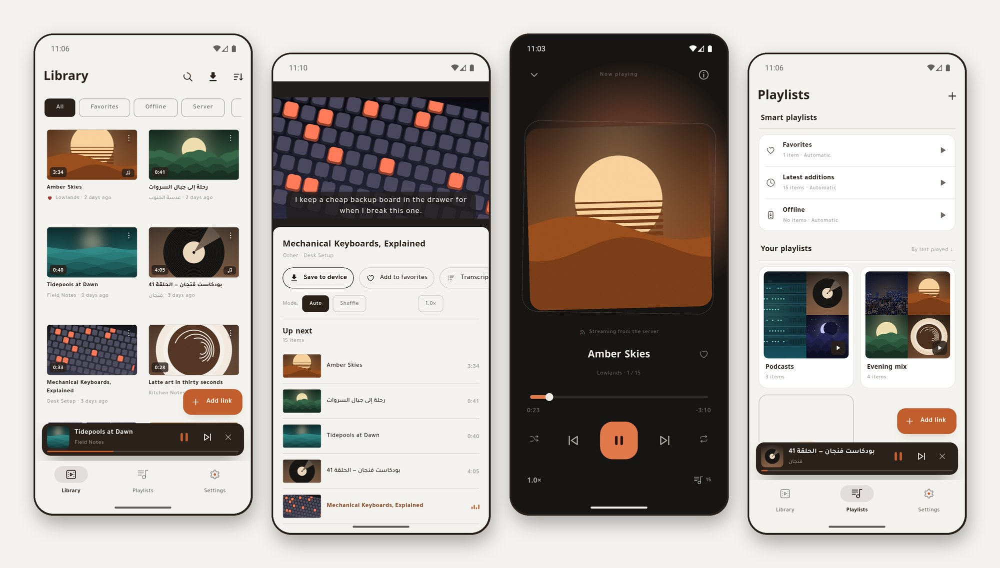
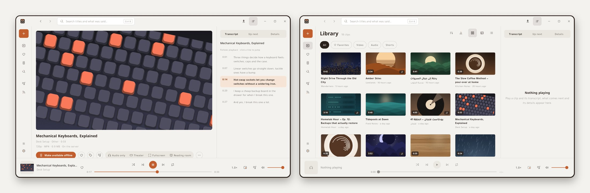
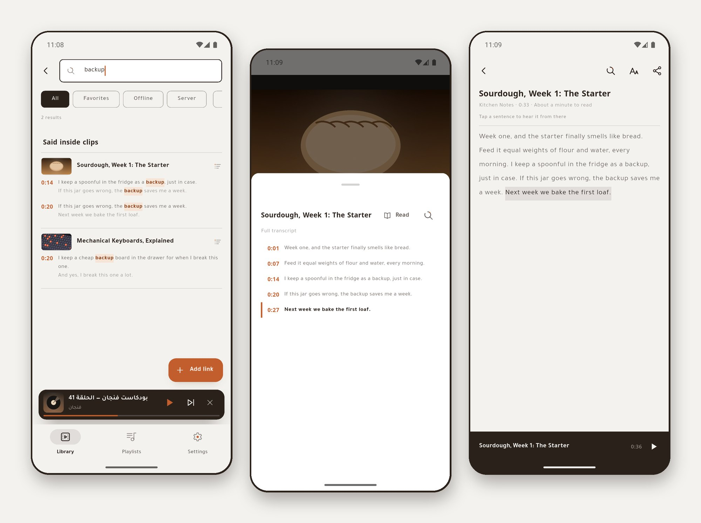
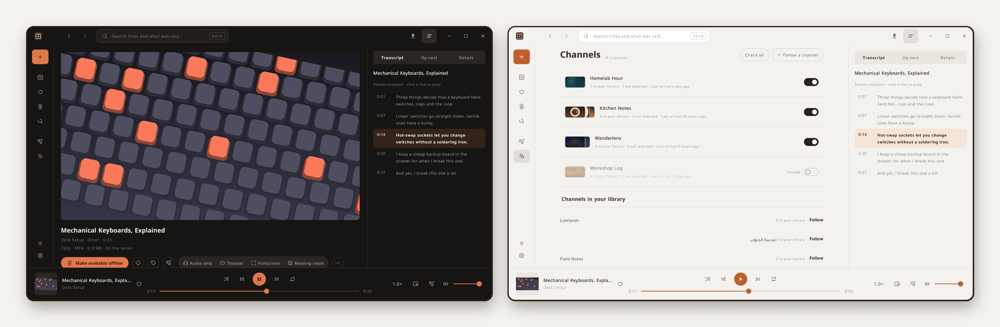
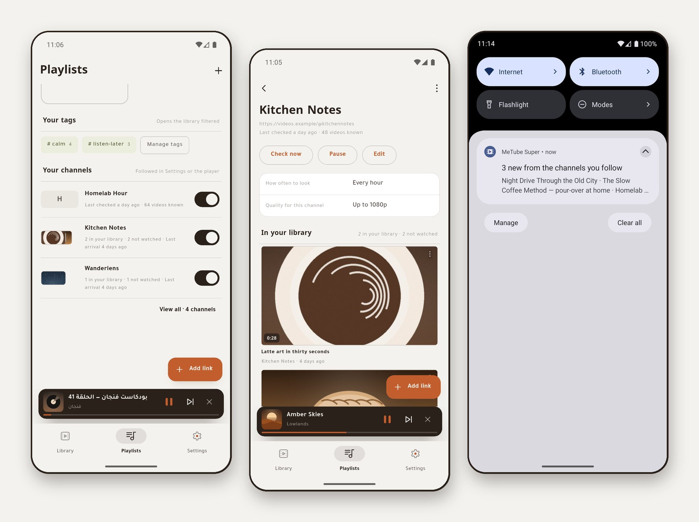
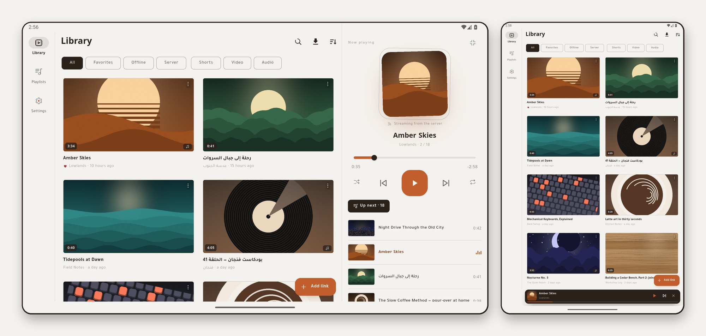
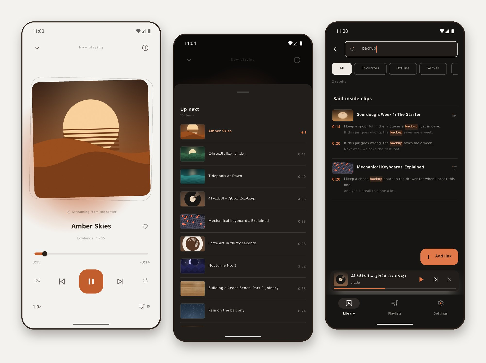
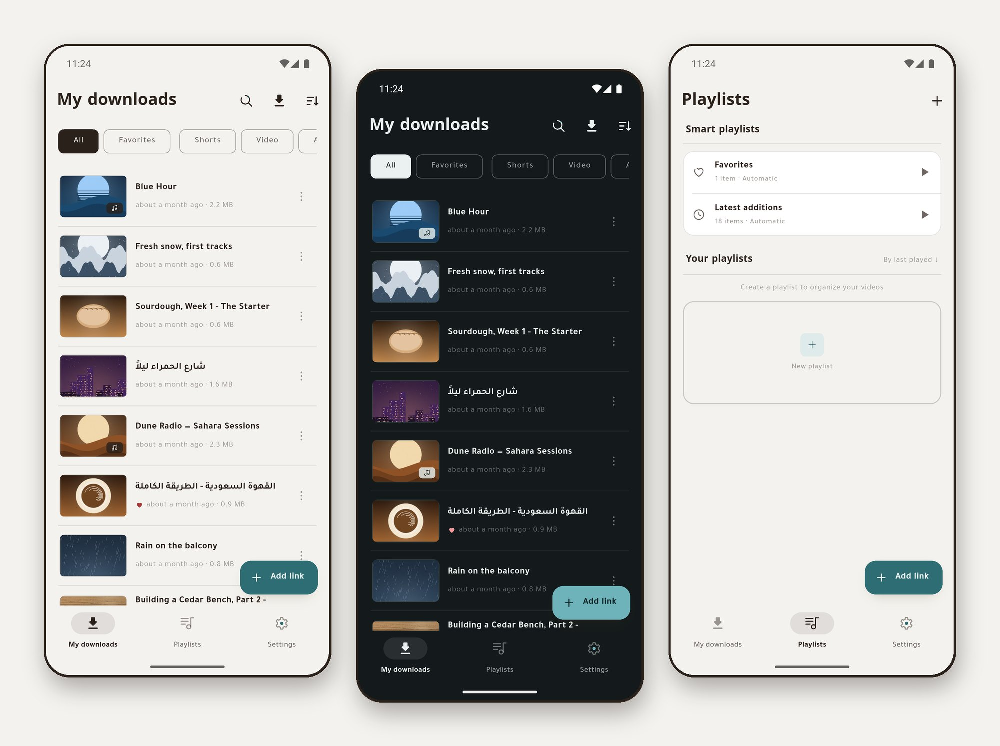

# MeTube Mobile

**English** · [العربية](README.ar.md)

[](https://github.com/sagheerys/metube-mobile/actions/workflows/ci.yml)
[](https://github.com/sagheerys/metube-mobile/releases/latest)
[](LICENSE)
[](#requirements)
[](https://flutter.dev)

**Two Android apps and a Windows app for a self-hosted
[MeTube](https://github.com/alexta69/metube) server** — the yt-dlp web
downloader you already run on your NAS or homelab. Queue a link from your
phone or your computer, watch the download happen, then keep the file on the
server and stream it, or pull it to the device and let the server clean itself
up. MeTube Super and MeTube Ember can also **follow a channel**: your server
downloads each new video by itself, and the app tells you when it arrives.
They can also **search inside your clips**, finding what was said in them and
not only their titles. Written in Flutter as one monorepo, in Arabic and
English, for phones, tablets and Windows, and free software under the GPL.

<p align="center">
  
</p>
<p align="center"><sub>MeTube Super — the merged library, a video streaming with its subtitles and up-next queue, the audio player at night, and playlists. Every title and cover here is invented.</sub></p>

<p align="center">
  
</p>
<p align="center"><sub>MeTube Ember, new in 2.7.0 — the same library on Windows: the transcript follows the video and a click jumps to any line; on the right, the library as a grid.</sub></p>

<p align="center">
  
</p>
<p align="center"><sub>MeTube Lite, start to finish: share a link, the server downloads it, the phone pulls the file, the server cleans up. Invented demo data; the waiting is sped up 3×.</sub></p>

> **Unofficial.** This project is not affiliated with, endorsed by, or connected
> to the MeTube project or its authors, nor to yt-dlp. It is an independent
> client that talks to a MeTube server over its HTTP API. The name "MeTube" is
> used only to say what these apps connect to.

| | **MeTube Lite** | **MeTube Super** | **MeTube Ember** |
|---|---|---|---|
| Runs on | Android | Android | Windows 10 and 11 (x64) |
| Made for | family and friends who just want the file | the person who runs the server | the same person, at a computer |
| After a download completes | pulls it to the device, then **deletes it from the server** | **keeps it on the server** | **keeps it on the server**; a copy to this computer when you ask |
| Library | a scan of the local folder | `/history` + the local index, merged into one list | the same merged library, as a grid, a table or a compact list |
| Playback | local files | streaming from the server **and** local files | streaming and local files, in the window or a mini window |
| Exclusive | an optional Wi-Fi-only rule, server cleanup | channel subscriptions, search inside clips, subtitles over the video, tags, batch downloads, "make available offline", server switching | everything in Super's column, plus Ctrl+K, a reading room, drag a clip out to Explorer, and the keyboard |

The three apps share the same core, media and design packages, and all ship in
**Arabic and English** with a right-to-left-first layout.

## Features

<details>
<summary><strong>In both phone apps</strong> — links, downloads, the library, playing, shorts, tablets, playlists, settings, updates</summary>

**Getting a link in.** Paste, or let the add button notice a link already on
the clipboard; share to the app from YouTube, TikTok or anything else — it
works from a cold start and takes several links at once. Links are recognised
and normalised across YouTube, X, Instagram, TikTok, Facebook, Vimeo, Reddit,
Twitch clips and SoundCloud, short links are followed (never downgrading HTTPS
to HTTP), and a playlist link opens the batch screen instead of queueing one
item.

**Downloading.** Four stages — hand the link to the server, follow its
progress, pull the file, then apply the app's delete policy — with live
percentages, one download at a time so a small server is not swamped, clean
cancellation that removes the partial file and tidies the server, three
retries with backoff for a dropped connection, and errors named rather than
swallowed (a platform asking for a login says so). Progress, completion and
failure each get a notification.

**Video, shorts, audio.** The library's chips sort every clip into exactly
one of them, so videos can be seen without the shorts.

**Batch downloads.** A playlist arrives as a screen: every item with its
duration, select some or all, the total of what you picked, video or audio,
and one quality for the batch.

**The library.** Search by title; sort by date, name or size and keep the
choice; switch between rich cards and a compact list; pull to refresh; filter
video against audio; long-press for multi-select to delete, share, or add to a
playlist in one go. Thumbnails come from a disk and memory cache, are
generated from local video, read from the cover embedded in audio files, or
fetched for SoundCloud.

**Playing.** Three shapes — immersive portrait, landscape with full controls,
and an audio mode with artwork — plus an in-player queue, autoplay, repeat one
or all, shuffle, a playback speed that is remembered, resume from where you
stopped, and the screen kept awake. Audio keeps playing in the background with
a media notification and lock-screen controls, a mini player sits above the
main screens, and leaving the video player offers to continue the same item as
audio **from the same second**.

**Shorts.** Any portrait clip of three minutes or less opens in a swipeable
full-screen lane that skips over everything that is not a short, with a tap to
pause, a double tap to favourite, and its own chip in the library.

**Tablets.** On a tablet, upright or on its side, both apps use the room
instead of stretching the phone layout: navigation moves to a side rail,
settings open in two panes, and the library's views spread into columns, with
the list shown as a table. Held sideways, a "Now playing" panel sits beside the
library, and a video plays beside its details and queue. Small 8-inch tablets
count too; phones keep their own layout.

**Favourites and playlists.** A heart on every card; playlists you create,
reorder by dragging, play in order or shuffled; and smart playlists that keep
themselves — favourites, latest additions, and (in Super) everything available
offline.

**Settings and safety.** Settings open on a short home page in three groups
(server, app, data), each row showing the setting as it stands. Default quality, theme (system, light or dark), and
language — Arabic or English, matched to the phone on first launch. Backups
are plain text holding no secret, written by themselves after every change,
keeping the last seven by date, restorable by picking a date, and exportable;
the three older encrypted formats can still be read. A diagnostic log viewer
can be shared only after URLs, IP addresses, credentials and storage paths are
stripped out.

**Updating itself.** Each app checks this repository for its own newer
release, downloads the APK, and hands it to the system installer. Nothing
installs without your confirmation, and a version can be skipped. The first
launch after an update shows what is new in it, and Settings → Updates opens
that again at any time.

</details>

<details>
<summary><strong>MeTube Ember (Windows)</strong> — the library in a window, Ctrl+K, a reading room, channels, copies to this computer, sync</summary>

The owner's app on a computer, new in 2.7.0, reading the same server as
MeTube Super:

- **The library in a window**: a grid, a table or a compact list, with the
  player beside it, a mini window that stays on top, and the transcript
  following the video in a side panel.
- **Ctrl+K** searches the titles and what was said in them, and runs any
  command; `?` lists every key, and the media keys and Windows' media flyout
  work as they should.
- **A reading room** for long talks, chapters, quotes copied with their
  second, and library statistics that suggest and never delete.
- **Channels and arrivals**, as in Super, with a Windows notification when
  a followed channel brings something.
- **To this computer**: download a clip, keep an offline copy, or drag a clip
  out to Explorer or the desktop; Ctrl+C copies its link and Ctrl+Shift+C
  the file itself.
- **A "To Ember" button for your browser**: one click on a video's page opens
  the add dialog with that link; links from the MeTube browser extensions
  open it too.
- **Sync with your phone**, optional and off until you choose a folder: tags,
  favourites, playlists, resume positions and transcripts travel between
  Super and Ember through a folder a program of your choice keeps in sync
  ([how to set it up](docs/SYNC-SETUP.md)).
- Installs for your user only, with **no administrator rights**, finds your
  server on the home network when you set it up, sits by the clock when
  closed if you want it to, and updates itself.

</details>

<details>
<summary><strong>MeTube Lite only</strong> — pulls the file to the phone and clears the server, Wi-Fi only</summary>

- **Pulls the file to the phone and then deletes it from the server**, so a
  server shared with family and friends does not fill up.
- **An optional Wi-Fi-only rule** — off unless you turn it on — that holds
  transfers back on mobile data; the tasks wait and resume by themselves.
- A library built by scanning the app's own download folder, with a platform
  filter and live counts.
- Finished files are registered with Android so they appear in the phone's
  gallery.

</details>

<details>
<summary><strong>MeTube Super only</strong> — subscriptions, search inside clips, read along, subtitles, tags, offline, sync</summary>

- **Subscriptions**: follow a channel or playlist, and your MeTube server
  checks it on a schedule and downloads each new video into the same
  library — only what appears from then on, not the channel's archive.
  Pause, rename, check now, or keep only titles containing a word. One
  notice for each batch a subscription brings, shown when the app next
  reaches the server; what you download yourself, from any device, is never
  announced as an arrival. Needs a MeTube recent enough to have subscriptions; an older one
  says so.
- **Search inside your clips** (off until you turn it on, in Settings →
  Transcripts): each YouTube clip you add has its subtitles fetched from your
  server and kept on the phone, so a library search also lists the clips in
  which your words were said, with the moment for each. Tap one to play from
  that second. A server set to write subtitles beside each clip (one line in
  its configuration, in the setup guide) covers everything it downloads,
  subscriptions included.
- **Read along**: a clip with a transcript opens it beside the audio or video
  player, with the line being said marked as it plays and a tap on any line
  to jump there.
- **Subtitles over the video**: a clip with a transcript can show its words over
  the picture as they are said, in three sizes and with a choice of background.
  A clip with subtitles in two languages switches between them with one button
  (in the shorts, a tap on the words themselves), and the choice is kept.
- **Cookies from the phone** for the sites that want a login: pick the files
  exported from your browser, several platforms at once, and they are merged
  into the single file the server keeps.
- **Keeps the file on the server** and merges `/history` with the local index
  into one library keyed by canonical URL, with filters for everything,
  what is offline, and what is only on the server.
- **Streams from the server** with authentication, and always prefers a local
  copy when one exists — the resume position is shared between the two.
- **Tags** you create and attach to anything, as chips in the library and a
  screen to rename or delete them.
- **Make available offline**: keep a local copy while the original stays on
  the server; remove just the local copy; share the local file if there is one
  and download-then-share if there is not.
- Batch operations, including tagging many items at once.
- **Sync with the computer** (optional): mirrors your tags, favourites,
  playlists, positions and transcripts with MeTube Ember through a folder you
  choose, and says so when a device has gone quiet for days
  ([how to set it up](docs/SYNC-SETUP.md)).
- **A local address and external ones**, tried again on every network change
  so the phone uses the fast path at home and the tunnel elsewhere, with a
  live status dot for each and a server card in settings.

</details>

## Screenshots

**Search inside clips** (Super and Ember): a word found inside two clips, the
transcript following playback, and the reading mode:



<details>
<summary><strong>More screens</strong> — Ember at night, subscriptions, tablets, the players, MeTube Lite</summary>
<br>

**MeTube Ember at night, and its channels** — the transcript beside a video,
and the channels your server follows with what each has brought:



**Subscriptions** — your channels in the playlists tab, one channel's page,
and the notice when a subscription brings new videos:



**On a tablet** — held sideways, the library with the "Now playing" panel
beside it; upright, the library in two columns:



**The players** — the audio player, the up-next queue at night, and a search
at night:



**MeTube Lite** — its downloads by day and by night, and its playlists:



</details>

The library shown is invented for these screenshots — the titles, the channels
and the covers are all generated, and no real server or account appears in
them. Every screen, one by one, is on the
[project page](https://sagheerys.github.io/metube-mobile/).

## Download

Every release carries one file per app on the
[releases page](https://github.com/sagheerys/metube-mobile/releases) —
[the newest is here](https://github.com/sagheerys/metube-mobile/releases/latest),
and the badge above names its version:

| File | App |
|---|---|
| `MeTube-Lite-<version>.apk` | MeTube Lite, for family and friends |
| `MeTube-Super-<version>.apk` | MeTube Super, for the server owner |
| `MeTube-Ember-<version>-windows-x64-setup.exe` | MeTube Ember, for Windows |

The APKs are signed. Android will ask you to allow installing from this source
the first time; that permission is per application, and you can withdraw it
afterwards. The two phone apps are separate and install side by side.

The Windows installer is not signed with a certificate yet, so Windows
SmartScreen may say it "protected your PC": choose **More info → Run anyway**.
It installs for your user only and asks for no administrator rights.

All three update themselves: **Settings → Updates → Check for updates** fetches
the newest release and hands it to the installer. Nothing is installed without
you confirming it.

Or build from source, below.

## Requirements

- A reachable MeTube server (this is a client — it downloads nothing by itself).
  Four of its settings change how the apps behave; see
  **[docs/SERVER-SETUP.md](docs/SERVER-SETUP.md)**.
- Using both apps? A server each is recommended — Lite clears the server and
  Super keeps it, and one instance cannot do both. The guide says why, and one
  server is still fine if you are its only user.
- Android for Lite and Super (`compileSdk 37`; the minimum SDK follows the
  Flutter toolchain default), or Windows 10 or 11 on x64 for Ember.
- Flutter **3.47.2** (Dart SDK `^3.13.0`) to build from source.

## Getting started

```bash
git clone https://github.com/sagheerys/metube-mobile.git
cd metube-mobile
flutter pub get

# debug
cd apps/metube_super && flutter run        # or apps/metube_lite
cd apps/metube_desktop && flutter run -d windows

# release
cd apps/metube_super && flutter build apk --release
cd apps/metube_desktop && flutter build windows --release
```

Release builds are signed from `apps/<app>/android/key.properties`, which is
**not** in this repository. Create your own keystore, or build debug.

On first launch, open **Settings** and enter your server URL (plus username and
password if your server is behind basic auth).

## Layout

```
packages/mt_core     pure Dart: MeTube API client, download engine, storage,
                     backup, logging — no Flutter imports
packages/mt_media    playback: audio_service handler, playback sources, position
                     and state stores, mini player
packages/mt_ui       the "Wahaj" design system: tokens, themes, shared widgets,
                     localization (ar/en)
packages/mt_transcripts  pure Dart: transcripts, their search and reading
apps/metube_lite     the edition for family and friends
apps/metube_super    the server-owner edition
apps/metube_desktop  MeTube Ember, the server-owner edition for Windows
docs/                the repository map, the server contract and the server setup
```

Dependency direction is one-way: `apps → mt_media → mt_core`. `mt_ui` knows
nothing about the server, `mt_core` and `mt_transcripts` contain no Flutter
code, and Lite does not use `mt_transcripts`.

## Tests

```bash
cd packages/mt_core        && dart test        # 701
cd packages/mt_transcripts && dart test        # 116
cd packages/mt_media       && flutter test     # 415
cd packages/mt_ui          && flutter test     # 274
cd apps/metube_lite        && flutter test     # 173
cd apps/metube_super       && flutter test     # 495
cd apps/metube_desktop     && flutter test     # 741
```

**2,915 tests** at the time of writing, and `flutter analyze` is expected to be
clean. Fixtures come from real server JSON, and every fixed defect leaves behind
a test that fails on the old code.

## Translations

The UI has no hardcoded strings: everything lives in
`packages/mt_ui/lib/src/l10n/app_en.arb` and `app_ar.arb`.

Adding a language is two steps — a new `app_<code>.arb` next to those, and one
line in `packages/mt_ui/lib/src/l10n/language_names.dart` giving the language's
name **in its own language**. The settings screen builds its list from
`supportedLocales`, so a new language appears by itself. Run
`cd packages/mt_ui && flutter gen-l10n` afterwards.

Translations are very welcome — see [CONTRIBUTING.md](CONTRIBUTING.md).

## Documentation

| | |
|---|---|
| [docs/ARCHITECTURE.md](docs/ARCHITECTURE.md) | The map of the repository: the packages, the rules that hold them together, where a feature belongs, how to run the tests. English first, with an Arabic version below it. |
| [docs/SERVER-API.md](docs/SERVER-API.md) | The contract with the MeTube server: every request and response, the local storage schema, and the traps that each cost a debugging session. Read it before touching networking or storage code. |
| [docs/SERVER-SETUP.md](docs/SERVER-SETUP.md) | How to configure the server, the four settings whose absence looks like an app defect, and how to reach it safely from outside. |
| [docs/SYNC-SETUP.md](docs/SYNC-SETUP.md) | Sync between MeTube Super and MeTube Ember, step by step: at home with Syncthing, or through a cloud drive. |
| [CONTRIBUTING.md](CONTRIBUTING.md) | What a change has to satisfy before it lands. |
| [CHANGELOG.md](CHANGELOG.md) | What changed, release by release. |
| [SECURITY.md](SECURITY.md) | Reporting a vulnerability. |

The project's working language is Arabic; the documents are written in English,
and issues and pull requests are welcome in either language.

## Credits

- [MeTube](https://github.com/alexta69/metube) by alexta69 — the server these
  apps are clients for (AGPL-3.0).
- [mpv](https://mpv.io) through [media_kit](https://github.com/media-kit/media-kit)
  — the player in MeTube Ember.
- [yt-dlp](https://github.com/yt-dlp/yt-dlp) — what MeTube uses to do the actual
  downloading (Unlicense).
- The Flutter and Dart teams, and the authors of the packages listed in each
  `pubspec.yaml`.

## License

[GPL-3.0](LICENSE) — Copyright (C) 2026 Yasir Sagheer.

This program is free software: you can redistribute it and/or modify it under
the terms of the GNU General Public License as published by the Free Software
Foundation, either version 3 of the License, or (at your option) any later
version. It is distributed **without any warranty**; see the license for
details.
